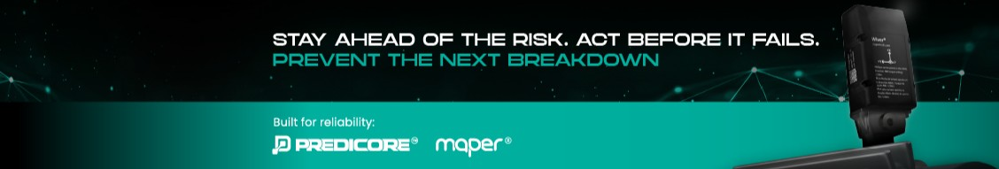

  

# Maper | Predicore

**Make your next stop a planned one.**

Maper is a predictive monitoring platform serving industry across the Americas since 2016. We watch critical assets around the clock and turn every anomaly into a diagnosis reviewed by ISO 18436 certified analysts, with the recommended action and its priority.

We close the full loop: detection, diagnosis, notifying the person responsible, and a confirmed, traceable intervention. Every validated repair feeds back into the model.

## A 100% in-house stack

- **Wiver™ sensors**: wireless triaxial vibration and temperature, with variants for high temperature, explosive atmospheres and intermittent assets.
- **Gateway**: its own cellular modem, independent of the plant's IT network, with satellite connectivity support.
- **Maper AI™**: trained on more than 5,000 real assets; learns how each machine operates.
- **Maper App**: web and mobile, unlimited users, full traceability of every intervention.
- **Monitoring Center**: certified analysts reviewing every diagnosis, every day.

We specialize in the assets where generic monitoring fails: equipment under 100 RPM, presses, robots, variable frequency drives and furnaces, using a detection method with a patent filed at the USPTO.

## By the numbers

- **200+** industrial customers
- **5,000+** real assets Maper AI has learned from
- **10** years of predictive R&D

## Engineering

We build everything in-house: PCBs, embedded firmware, the gateway's Linux OS, the cloud platform and the AI models.

## Links

- Latin America: <https://mapertech.com>
- United States: <https://predicore.com>
- LinkedIn: <https://www.linkedin.com/company/mapertech>
